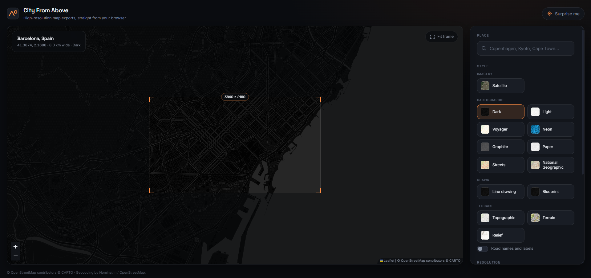

# City From Above

Type a city, frame it, and download a high-resolution top-down image of it —
satellite, neon, hand-drawn terrain, or ten other looks. Everything runs in the
browser: no backend, no build step, no API keys.

> **Screenshot placeholder.** Save a capture of the app to `docs/screenshot.png`
> and uncomment the line below.
>
> <!--  -->

## What it does

- **Search any place** via [Nominatim](https://nominatim.openstreetmap.org/),
  with a debounced dropdown of matches.
- **Frame it live** on a draggable Leaflet map. An overlay rectangle shows
  exactly the ground area that will be exported, at the aspect ratio of the
  chosen resolution.
- **12 styles** grouped as Imagery, Cartographic and Terrain — including
  a Neon treatment of the CARTO dark basemap.
- **Turn road names and labels off.** Three different mechanisms sit behind one
  switch: CARTO's label-free tile variants, Esri's separate reference overlays
  (which is also what gives satellite a proper hybrid), and layers such as
  OpenTopoMap that bake labels into the tile and therefore cannot strip them —
  where the switch is disabled and explains itself.
- **Pick a resolution** from square, landscape, portrait and 300 dpi print
  presets, or enter a custom size up to 6000 px per side.
- **Set the coverage** — how many kilometres wide the captured area is, from
  0.5 km to 50 km. This is the control that makes a larger export actually
  contain more detail rather than the same picture upscaled.
- **Export as PNG, JPG, JPEG or WEBP**, with a quality slider for the lossy
  formats, an optional burned-in caption, and six finishes.

## How the export works

`js/render.js` does not screenshot the map. Screenshotting caps you at the size
of the browser window and bakes in whatever the DOM happened to be showing.
Instead it:

1. Picks the integer zoom at which the requested coverage maps onto at least
   the requested pixel width:
   `z = ceil(log2(156543.03392 * cos(lat) * targetWidth / coverageMeters))`,
   clamped to the layer's maximum zoom.
2. Computes the tile range covering that ground rectangle in Web Mercator and
   fetches the tiles directly, six at a time, with two retries each and a
   neutral placeholder for anything that still will not load — one dead tile
   never kills the render.
3. Draws them onto an offscreen canvas at native tile resolution, which is
   usually *larger* than what was asked for, then downscales in halving steps
   with high-quality smoothing. That is what makes 4K genuinely sharper than
   1080p rather than blurrier.
4. Burns the layer's attribution into the corner and encodes the result.

Label overlays are drawn as additional passes over the same tile grid, so a
hybrid satellite export is three passes: imagery, boundaries and places, then
transportation.

## Run locally

Any static file server will do — ES modules will not load over `file://`.

```bash
python3 -m http.server 8000
```

Then open <http://localhost:8000>.

## GitHub Pages

The repository is the site: `index.html` sits at the root, and `.nojekyll`
stops Pages from running the files through Jekyll (which would otherwise ignore
directories beginning with an underscore and add a build step this project does
not need).

To publish: **Settings → Pages → Source: Deploy from a branch**, then pick the
`main` branch and the `/ (root)` folder. Pushing to `main` republishes.

## File layout

```
index.html        markup and CDN links
css/style.css     hand-written CSS, custom properties, no framework
js/main.js        UI wiring: search, preview map, framing, export controls
js/geocode.js     Nominatim client — rate limited and cached
js/tiles.js       tile layer catalogue and Web Mercator maths
js/render.js      offscreen tile stitcher (the export renderer)
```

## URL state

The hash carries `#lat,lon,zoom,style,resolution,coverage,labels`, so any view
is a shareable link and survives a reload. The last search is also kept in
`localStorage`.

## Attribution and licensing

The exported image has the relevant credit burned into its corner. That is a
licensing requirement of every provider below, not decoration — please leave it
in place when you share an export.

- **Esri World Imagery** — imagery © Esri, Maxar, Earthstar Geographics.
  Used via the public ArcGIS Online tile services.
- **Esri basemaps** (Street, Topographic, Canvas, National Geographic,
  Hillshade, reference overlays) — © Esri and its data partners, including
  HERE, Garmin, USGS, NOAA, NASA, NGA and the OpenStreetMap contributors.
- **CARTO basemaps** (Dark, Light, Voyager, and the Neon treatment built on
  Dark) — © [CARTO](https://carto.com/attributions), map data
  © [OpenStreetMap](https://www.openstreetmap.org/copyright) contributors.
- **OpenTopoMap** — map data © OpenStreetMap contributors and SRTM, style
  © [OpenTopoMap](https://opentopomap.org), licensed CC-BY-SA.
- **Nominatim / OpenStreetMap** — geocoding data
  © OpenStreetMap contributors, ODbL. The client here honours the usage policy:
  at most one request per second, results cached in memory, no bulk querying.
- **Leaflet** — © Vladimir Agafonkin, BSD 2-Clause.

Each provider sets its own terms for how many tiles you may pull and what you
may do with the output. Check them before using exports commercially or
generating them in bulk.

## Licence

MIT — see [LICENSE](LICENSE).
